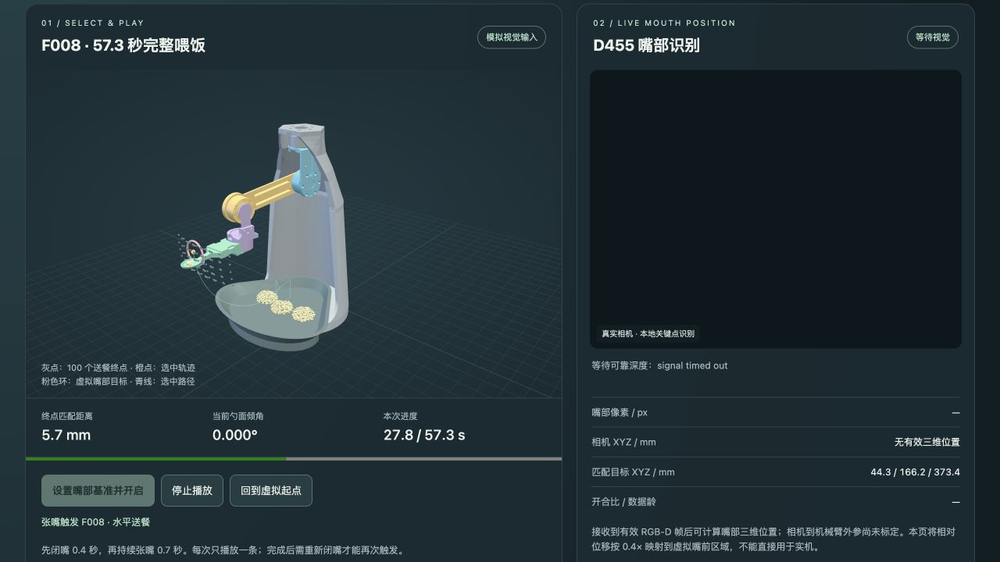
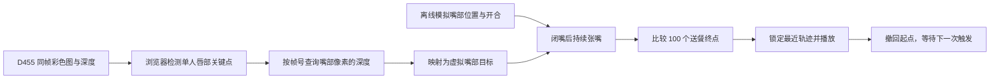

# EAT-RDK · 面向地瓜 RDK X5 的视觉交互喂饭仿真

使用者张开嘴时，餐勺应该去哪里？EAT-RDK 用人脸关键点判断张嘴意图，用 RGB-D 深度估计嘴部位置，再从 100 条预生成轨迹中选出送餐终点最近的一条。开发者可以看到为什么选中这条轨迹，以及虚拟四轴机械臂如何舀取、调平、送到嘴前、停留和撤回。

**当前进度**　桌面仿真和算法测试已通过。RDK X5 部署入口、只读相机服务和复现步骤已整理，开发板实测待完成。当前演示使用浏览器 CPU/WASM 做人脸推理，运动输出限于三维场景。



*桌面原型实录截图。粉色圆环是模拟嘴部目标，灰点是候选送餐终点。默认演示中选中 F008，匹配距离 5.7 mm，全程约 57.3 秒。*

## 第一次运行

安装 Git 和 Python 3.9 或更高版本，在电脑或目标板上执行以下命令。离线演示无需相机、Node.js 或视觉模型。

```bash
git clone https://github.com/tree1129/EAT-RDK.git
cd EAT-RDK
python3 server.py
```

打开 <http://127.0.0.1:8766/>，使用支持 WebGL 和 ES Modules 的桌面浏览器。滚动到「离线体验」，点击「模拟张嘴 → 选最近轨迹」。观察排名表第一行、场景里的勺面倾角和播放进度。改变 X/Y/Z 偏移后再次运行，就能比较目标移位前后的轨迹。点击「录制模拟演示」可以录制三维场景，完成后下载视频。录制期间保持页面在前台。

没有显示器的 RDK X5 可以运行同一服务，电脑通过 SSH 转发打开页面。板端启动方法、相机依赖和验收步骤见 [RDK X5 部署与验证](docs/RDK_X5.md)。

## 一次张嘴如何选中一条轨迹



1. **定位**。固定 D455，彩色帧与对齐后的 Z16 深度共用帧号。程序以两唇内缘中点作为查询像素，取 7×7 邻域有效深度中位数，通过相机内参反投影得到相机 XYZ。深度超过 500 ms、有效像素少于 25 个或深度分布跨越明显边缘时，程序拒绝该观测。
2. **确认意图**。用上下唇间距除以嘴角间距衡量张嘴程度。稳定建立基准后，开合比 ≤0.08 持续 0.4 秒，再达到 ≥0.18 持续 0.7 秒，产生一次触发。一直张嘴只触发一次。
3. **检索**。当前映射为 `虚拟基准 + 0.4 × (当前相机位置 − 相机基准)`。对每条轨迹计算虚拟嘴部目标与送餐终点的三维欧氏距离，按距离排序。最近距离超过 25 mm 时本轮不播放。这个数值是虚拟场景的匹配容差，真实嘴部定位误差和实际送达误差仍需分别测量。
4. **播放**。触发时锁定轨迹编号，共用的取餐动作允许勺面下倾，随后按关节轨迹调平。送餐、等待和撤回段用运动学核对勺面方向。丢脸、多人、观测超时或目标明显移动会暂停，送餐与等待阶段检测到闭嘴也会暂停。

## 为什么选择 RDK X5

RDK X5 具备 USB 3.0 Host、ARM CPU 和 BPU，地瓜机器人提供 Ubuntu 22.04 系统镜像。本项目把 D455 接在 USB 侧，由板端 Python 服务保管短时帧缓存并提供同帧深度查询。开发者可以先用 PC 浏览器渲染和识别，独立测量板端采集质量，再试板端浏览器或 BPU 推理。现阶段没有 X5 帧率、功耗或 BPU 性能数据。[RDK X5 产品规格](https://developer.d-robotics.cc/rdkx5) · [地瓜机器人开发手册](https://d-robotics.github.io/rdk_x_doc/RDK/)

| 组成 | 当前执行位置 | 可检查的结果 |
|---|---|---|
| Python 页面服务、可选 D455 采集 | 部署主机，目标为 X5 | `/health`、RGB-D 帧号、帧龄、有效深度数量 |
| 唇部关键点、意图判断、轨迹排名 | 打开页面的浏览器 | 像素、开合比、虚拟 XYZ、最近五条轨迹 |
| ARC4 CAD 网格与四轴运动学 | 浏览器 Three.js 场景 | 实际播放的轨迹编号、阶段、倾角、时间 |
| 轨迹生成与回归 | 开发机 Node.js / Python | 可重建轨迹库、逐条指标、失效条件测试 |

## 轨迹库与测量口径

生成器在已有送餐姿态附近组合 5 个偏航偏移、5 个联动俯仰偏移和 4 个腕部偏移，得到 F001 至 F100。每条轨迹包含四个阶段的时间与关节角，角度单位为弧度，时间单位为秒。送餐段使用五次平滑插值。生成时检查相邻阶段连续性、等待段静止、返回公共起点，并在采样点与中点计算勺面倾角。

| 本版仿真指标 | 结果 |
|---|---:|
| 完整轨迹 / 不同送餐终点 | 100 / 100 |
| 单轮时长 | 51.4–59.6 s |
| 输送段最大采样末端速度 | 29.94 mm/s 以内 |
| 输送段最大采样关节速度 | 10.18°/s 以内 |
| 送餐、等待和撤回最大计算倾角 | 小于 0.001° |

以上来自几何与运动学模型。相机到机械臂的外参、实际勺尖偏移、关节零位与限位、整机碰撞和食物接触均待实体验证。仓库只提供虚拟嘴前呈递。[逐轨迹检查结果](reports/feeding-library-100-validation.json)

## 开发与复现

```bash
# Node.js 18+，无需安装 npm 依赖
npm test
npm run generate

# 深度质量、帧缓存和 HTTP 接口测试
python3 -m venv .venv
. .venv/bin/activate
python -m pip install -r requirements.txt
python -m unittest discover -s tests -p 'test_*.py' -v
```

本地验证包括 26 项 JavaScript 测试和 10 项 Python 测试。其中相机接口测试使用合成深度帧和 SDK 测试替身。原型曾在另一台 Ubuntu 主机验证 D455 接口，当前仓库的独立采集程序与 RDK X5 组合仍需现场验证。

| 想了解的内容 | 从这里开始 |
|---|---|
| 离线启动、页面与只读代理 | [server.py](server.py) |
| 张嘴触发、最近轨迹与播放状态 | [smart-feeding-core.mjs](web/smart-feeding-core.mjs) |
| 100 条轨迹的来源与生成 | [生成器](integrations/d455/generate_feeding_library.mjs) · [基准轨迹](web/feeding-trajectory.json) |
| 真实 RGB-D 输入 | [采集服务](camera/realsense.py) · [深度质量检查](integrations/d455/mouth_depth.py) |
| 社区分享与演示流程 | [给地瓜机器人开发者的项目介绍](docs/SHOWCASE.md) |

Three.js 及配套加载器随仓库提供，许可见 [Three.js MIT License](web/vendor/THREE-LICENSE.txt)。可选视觉模型和 WASM 单独从上游获取，下载地址与 SHA-256 见 [资源清单](scripts/vision-assets.json)。
